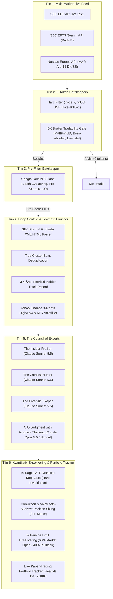

# 🦅 InsiderOps // Information Asymmetry & Executive Order Terminal

[](https://nextjs.org/)
[](https://turbo.build/)
[](https://www.typescriptlang.org/)
[](https://ai.google.dev/)
[](https://www.anthropic.com/)
[](LICENSE)

**InsiderOps** er en institutionel intelligence- og eksekveringsterminal designet til at detektere, dissekere og udnytte legal **informationsasymmetri** fra børsnoterede selskabers indberetninger af insiderhandler (**US SEC Form 4** og **Nordic MAR Art. 19**).

Systemet filtrerer automatisk markedsstøj (optioner, gaver, skatteafregninger, automatiske Rule 10b5-1 planer) fra og isolerer de sjældne **ægte åbne markedskøb (Kode P)** foretaget med personlige frie midler af C-Suite direktører (CEO, CFO, COO). En tiered flåde af AI-modeller (Google Gemini Flash + Anthropic Claude Sonnet & Opus) udfører dybdegående forensic analyse og fodnote-dekodning, hvorefter en kvantitativ eksekveringsmaskine beregner ATR-volatilitetsbaserede stop-losses, position sizing og live P&L i DKK.

---

## 🧭 Sådan bruger du InsiderOps

> **Ingen dokumenteret edge.** Backtesten (USA 2006–2026, Sverige 2016–2026) gav negativt nettoafkast efter omkostninger på 5 dage. Copy trading forventes at give omtrent markedsafkast minus omkostninger. InsiderOps er et værktøj til at *følge* insiderkøb og måle dine egne handler – ikke en dokumenteret strategi. Detaljer i [`research/reports/`](research/reports/).

### Daglig rutine

1. **Scan selv (intet kører automatisk):** klik "Scan Nu" i appen eller kør `npm run scan`. Scanner SEC Form 4 og Nasdaq Nordic; gatekeeperen (Claude Haiku) scorer rækkerne – ca. $0,01 pr. scan.
2. **Åbn appen** (`start.bat`). Indlæsning henter intet udefra: radaren viser den seneste gemte scan, og porteføljen de senest gemte kurser og valutakurser – alt med tidsstempel. Brug hurtig-filteret **🎩 CEO/CFO-køb** eller et af de andre.
3. **Rådet (valgfrit):** markér rækker og klik "Send Valgte til Rådet". Koster Sonnet/Opus-kald og kører kun, når du klikker.
4. **Handelsplanen** i rådskammeret: én ordre som standard, forventet round-trip i kr. og %, og en advarsel, når ordren er så lille, at minimumskurtagen slår igennem (USA ca. 16.700 kr., Norden 25.000 kr.).
5. **Handl i Nordnet.** Opret positionen (📌), vælg "Nordnet Live" under *Redigér / Nordnet Match*, og ret kurs og antal til Nordnets.
6. **Beregn udfald selv:** klik "Beregn udfald" på fanen *Måling* (eller kør `npm run outcomes`).
7. **Portefølje → Mine Nordnet-handler:** klik "Opdatér kurser & exit-radar" for live kurser, og se, om dine egne copy trades virker.

### Hvad tallene betyder

| Tal | Betydning |
|---|---|
| Asymmetri-score (0–100) | Gatekeeperens eller rådets vurdering af købet. Ikke en afkastprognose – backtesten fandt ingen regel, der slog de naive baselines efter omkostninger. |
| Stærkt signal / Overvåg / Støj | Rådets dom (≥ 75 / 60–74 / < 60). Kun visning – i databasen hedder de stadig `STRONG ASYMMETRY (KØB)` osv. |
| Forventet round-trip | Kurtage ved køb og salg (min. 25 kr. eller 0,15 % i USA / 0,10 % i Norden) + valutaspread + spread/slippage efter aktiens likviditet. Fra `config/costs.json`. To trancher = én minimumskurtage mere. |
| Alpha mod SPY | Positionens afkast i DKK minus SPY's afkast i DKK i samme periode, i procentpoint. |
| Netto afkast (Mine Nordnet-handler) | Realiseret + urealiseret afkast minus kurtage og veksling efter Nordnet-tariffen. Spread er allerede med i dine faktiske kurser. Salg af åbne positioner er ikke betalt endnu og ikke trukket fra. |
| Måling-fanen | Signal-ledgerens udfald efter 1, 5, 21 og 63 handelsdage, netto efter omkostninger, med usikkerhedsintervaller. |

### Konklusioner fra fase 4 (USA) og 4-SE (Sverige)

Primær metrik: netto abnormalt afkast efter 5 handelsdage (DKK, efter omkostninger) mod SPY (USA) eller ^OMXSBGI (Sverige). "Bestået" kræver, at den ensidede 97,5 %-nedre grænse ligger over 0.

| Marked og periode | Test | Enheder | Netto 5 d | Resultat |
|---|---|---|---|---|
| USA in-sample 2006–2024 | alle køb | 34.842 | −0,34 % [−0,60; −0,08] | negativ |
| USA holdout 2025–2026 | Test 1: basisstrategien | 3.643 | −0,17 % (nedre grænse −0,65 %) | ikke bestået |
| USA holdout 2025–2026 | Test 2: CEO/CFO-køb > 30 % under 52-ugers-toppen | 484 | +0,24 % (nedre grænse −0,63 %) | ikke bestået |
| Sverige in-sample 2016–2024 | Test 1: basisstrategien | 3.017 | −0,79 % (nedre grænse −1,08 %) | ikke bestået |
| Sverige in-sample 2016–2024 | Test 2: clusters i small/mid cap | 281 | −1,31 % (nedre grænse −2,09 %) | ikke bestået |
| Sverige holdout 2025–2026 | Test 1: basisstrategien | 1.126 | −1,11 % (nedre grænse −1,45 %) | ikke bestået |

- **Før omkostninger** er der en kort, positiv reaktion (USA +0,56 % på 5 dage), men kurtage, valuta og spread æder den.
- **63 handelsdage** var den eneste horisont, der ikke var negativ netto: USA in-sample +0,31 % [−0,42; +1,05], USA holdout +0,40 % [−1,50; +2,30] – ingen af dem signifikant. Sverige-holdout 63 dage: −2,48 % [−3,94; −1,03].
- **Konsekvens:** forvent markedsafkast minus omkostninger. Handl få og store ordrer frem for mange små.

Rapporter: [`backtest-v1.md`](research/reports/backtest-v1.md) (USA), [`backtest-se-v1.md`](research/reports/backtest-se-v1.md) (Sverige), præregistreringer i [`docs/prereg.md`](docs/prereg.md) og [`research/reports/prereg-se.md`](research/reports/prereg-se.md).

### Kørsel fra terminalen

Intet kører af sig selv. Vil du scanne eller beregne udfald uden at åbne appen, så kør det selv:

- `npm run scan` eller `npm run outcomes`.
- Med log i `data/logs/<job>-<dato>.log`: `powershell -NoProfile -ExecutionPolicy Bypass -File scripts/ops/run-job.ps1 -Job scan` (eller `-Job outcomes`).
- Kører dev-serveren, sender scan-jobbet scannen til den, så kun én proces skriver i databasen.

---

## 🚀 Hvad er nyt i InsiderOps v2.0 Quant Terminal?

InsiderOps v2.0 udvider platformen fra ren Form 4 scanning til en komplet institutionel kvantitativ investerings- og porteføljeterminal:

- **Unified Global Omni-Scanner**: Parallel, realtids-scanning af både amerikanske SEC Form 4 filings (Atom Feed & EFTS API) og nordiske Nasdaq Europe MAR Art. 19 indberetninger (København, Stockholm, Helsinki) med automatisk valutanormalisering (USD, DKK, SEK, EUR).
- **SEC XBRL Balance Sheet & Cash Runway Engine (`src/lib/fundamentals.ts`)**: Direkte integration med det officielle SEC EDGAR XBRL Company Facts API (`data.sec.gov`). Udtrækker 10-Q/10-K regnskabstal (kontantbeholdning, rentebærende gæld, nettokontanter og kvartalsvis cash burn) og beregner præcis **Cash Runway** i måneder, så emissionstruede selskaber afsløres øjeblikkeligt.
- **Short-Squeeze & Earnings Guard**: Realtime monitorering af **Short Interest** (% of Float), **Days to Cover** og næste regnskabsdato med automatisk helbredsklassificering (`FORTRESS_BALANCE`, `SOLID_RUNWAY`, `SHORT_SQUEEZE_SETUP`, `DILUTION_RISK`, `NEUTRAL`).
- **S&P 500 (`SPY`) Alpha Benchmarking**: Hver porteføljeposition benchmarks live mod S&P 500 (`SPY`) fra åbningstidspunktet og viser netto Alpha (+/- %) på positions- og porteføljeniveau.
- **Inline Nordnet Trade Editor (`PATCH /api/portfolio`)**: 1-kliks redigering af faktiske købskurser, kurtage/antal aktier og stop-loss/target, samt lynhurtig skift mellem `🧪 PAPER-TRADE` og `🏦 NORDNET LIVE HANDEL`.
- **Insider-Exit Radar (`checkInsiderExitRadar`)**: Tjekker åbne positioner for efterfølgende insider-salg (`Kode S`), når du klikker "Opdatér kurser & exit-radar", og advarer, hvis insidere tager gevinst eller flygter.
- **Smart Sniper Filter-Presets**: Hurtige 1-klik presets i radaren:
  - `🎩 CEO/CFO-køb` (fase 9): køb, hvor CEO/VD eller CFO er køber – også i et cluster. Samme rolleregel som backtesten.
  - `💎 Under Insider Pris (Rabat-Zone)`: Viser godkendte, DK-handelbare aktier, hvor aktuel børskurs er under insiderens købskurs.
  - `🔥 C-Suite + Cluster Conviction`: Isolerer tunge CEO/CFO handler eller handler med $\ge 2$ samtidige insidere over \$100.000.
- **1-Klik Desktop Launcher (`Start-InsiderOps.bat`)**: Start hele terminalen og Turbopack-serveren med ét enkelt dobbeltklik fra skrivebordet med automatisk browser-start på `http://localhost:3000`.

---

## 🏛️ Den 6-Trins Asymmetri-Tragt (Systemarkitektur)

InsiderOps anvender en streng 6-trins tragtarkitektur, der garanterer, at kun de absolut mest overbevisende handler når frem til kapitalallokering:



---

## 🔍 Dybdegående Gennemgang af Tragten

### 1. Multi-Market Scannere
- **Live SEC EDGAR Atom Feed**: Scanner alle seneste amerikanske Form 4 indberetninger i realtid via `https://www.sec.gov/cgi-bin/browse-edgar?action=getcurrent&type=4`.
- **C-Suite Executive Hunter**: Filtrerer målrettet efter CEO, CFO, COO, President og General Counsel med direkte personligt ejerskab (`OwnershipNature = 'D'`).
- **Nordisk MAR Art. 19 Scanner**: Henter ledelseshandler direkte fra Nasdaq Europe (Nasdaq Copenhagen & Nasdaq Stockholm) og mapper tickere med `.CO` og `.ST` suffikser.

### 2. 0-Token Hard Filter & DK Broker Tradability Gate
For at spare AI-tokens og beskytte dansk kapital afvises uegnede handler deterministisk uden API-kald:
- **Transaktionskode**: KUN ægte åbne markedskøb (`Kode P`). Salg (`S`), optioner/RSU (`M`, `A`) og skatteafregning (`F`) sorteres fra.
- **Minimumsværdi**: Handlen skal overstige \$50.000 USD (eller 350.000 DKK) for at repræsentere reel overbevisning.
- **Børs-whitelist**: Kun officielle markeder godkendes (`NASDAQ`, `NYSE`, `Nasdaq Copenhagen`, `Nasdaq Stockholm`). Amerikansk OTC / Pink Sheets afvises.
- **EU PRIIPs / KID Gate**: Amerikanske Closed-End Funds (CEF) og ETF'er uden EU Key Information Document (f.eks. `CLM`) blokeres automatisk for danske detailinvestorer.
- **Likviditets- og Penny Stock Filter**: Kursen skal være $\ge \$2.00$ og gennemsnitlig daglig omsætning $\ge \$500.000$ USD for at undgå illikvide spreads.

### 3. Gemini 3 Flash Batch Gatekeeper
- Analyserer hele batchet af beståede transaktioner i et enkelt prompt-kald.
- Tildeler en hurtig **Pre-Score (0–100)** og genererer en syntese af asymmetri-signalet (`HIGH`, `MEDIUM`, `LOW`, `NOISE`).

### 4. Deep Context Enricher & "Det med småt"
- **SEC Form 4 Fodnote-Parser**: Downloader den rå XML/HTML indberetning og udtrækker alle juridiske `<footnote>`-tekster (f.eks. vægtet gennemsnitspris, private placements, fonds-vehikler).
- **Rule 10b5-1 Detektor**: Scanner indberetningens Checkbox og fodnoter for forudbestemte handelsplaner. Hvis handlen er en 10b5-1 plan, neutraliseres asymmetriscoren, da handlen blev besluttet måneder forinden uden aktuel insider-viden.
- **True Cluster Buys**: Registrerer når flere *forskellige fysiske personer* i ledelsen køber i samme tidsvindue, mens fondsselskabers multi-entity indberetninger deduplikeres.
- **3-4 Års Historical Track Record**: Undersøger insiderens historiske køb for at identificere om vedkommende er en **🎯 Smart Money Sniper** (>70% Win-Rate) eller en **⚠️ Bagholder** (køber faldende knive).

### 5. The Council of Experts (Multi-Agent Råd)
Når en sag sendes til rådet, kaldes 3 specialister parallelt via `Promise.all` efterfulgt af en dommer:
1. **The Insider Profiler (Claude Sonnet 5.5)**: Analyserer insiderens magtbase, relative positionsøgning (% af formue) og historiske købsadfærd.
2. **The Catalyst Hunter (Claude Sonnet 5.5)**: Kigger fremad. Hvorfor køber ledelsen netop nu? Hvilke FDA-godkendelser, regnskaber eller produktlanceringer venter?
3. **The Forensic Skeptic (Claude Sonnet 5.5)**: Djævlens advokat. Leder efter gældsforfald, udvanding, PR-stunts og regnskabsfinter.
4. **Chief Investment Officer (Claude Opus 5.5 / Sonnet)**: Syntetiserer rapporterne med **Adaptive Extended Thinking (2048 tokens)**, afsiger en endelig dom (**Asymmetry Score 1–100**) og formulerer en konkret handlingsanvisning.

### 6. Kvantitativ Eksekvering, ATR Volatilitet & Paper Portfolio
Beregner en matematisk eksekveringsplan for frie midler:
- **14-dages ATR (Average True Range)**: Måler aktiens sande daglige svingningsbredde.
- **Volatilitetsjustering**: Biotek- og højvolatilitetsaktier (>5.5% dagsvolatilitet) nedskaleres automatisk med 25–40% i positionsstørrelse for at begrænse kronetabet.
- **Hard Invalidation Stop-Loss**: Sættes til:
  $$\text{Stop-Loss} = \min(\text{Aktuel Kurs}, \text{Insiderens Købskurs}) - (2.5 \times \text{ATR})$$
  (Sikkerhedsbegrænset mellem -7% og maksimalt -18%).
- **2-Tranche Ordre-Eksekvering**:
  - **Tranche 1 (60%)**: Markedsåbning / Limit ordre på aktuel kurs for at sikre basen.
  - **Tranche 2 (40%)**: Limit pullback ordre på støtteniveau i bunden af ordrebogen.
- **Live Paper-Trading Portfolio**: Track åbne positioner i realtid med live P&L i DKK, automatisk stop-loss / target hit registrering og win-rate beregning via Yahoo Finance.

---

## 📐 Kvantitative Formler

### 1. True Range & 14-Dages ATR
$$\text{TR}_i = \max\left(H_i - L_i,\; |H_i - C_{i-1}|,\; |L_i - C_{i-1}|\right)$$
$$\text{ATR}_{14} = \frac{1}{14} \sum_{i=1}^{14} \text{TR}_i$$
$$\text{Daglig Volatilitet \%} = \left(\frac{\text{ATR}_{14}}{\text{Aktuel Kurs}}\right) \times 100$$

### 2. Conviction & Volatilitets-Skaleret Allokering
Givet en brugerdefineret kapitalramme $K_{\text{DKK}}$ (f.eks. 25.000 kr.):

$$\text{Conviction Multiplikator } (C) = \begin{cases} 1.0 & \text{hvis Score } \ge 85 \\ 0.7 & \text{hvis } 75 \le \text{Score} < 85 \\ 0.4 & \text{hvis } 60 \le \text{Score} < 75 \\ 0.0 & \text{hvis Score } < 60 \text{ (Afvis)} \end{cases}$$

$$\text{Volatilitets Multiplikator } (V) = \begin{cases} 0.60 & \text{hvis Daglig Vol } > 8.0\% \\ 0.75 & \text{hvis Daglig Vol } > 5.5\% \\ 1.00 & \text{ellers} \end{cases}$$

$$\text{Allokering}_{\text{DKK}} = \text{round}\left(K_{\text{DKK}} \times C \times V\right)$$

### 3. Portefølje P&L i DKK
Givet en position med $S$ aktier, indgangskurs $P_{\text{entry}}$, aktuel kurs $P_{\text{nu}}$ og investeret beløb $I_{\text{DKK}}$:

$$\text{PnL \%} = \left(\frac{P_{\text{nu}} - P_{\text{entry}}}{P_{\text{entry}}}\right) \times 100$$
$$\text{PnL}_{\text{DKK}} = \text{round}\left(I_{\text{DKK}} \times \frac{\text{PnL \%}}{100}\right)$$

---

## 🛠️ Teknologier & Stack

- **Framework**: [Next.js 16](https://nextjs.org/) (App Router, Turbopack, Server Components, Route Handlers)
- **Sprog**: [TypeScript 5](https://www.typescriptlang.org/) (Strict typing på tværs af hele tragten)
- **Styling**: [Tailwind CSS 3](https://tailwindcss.com/) med cyberpunk/Bloomberg Terminal dark theme
- **Ikoner**: [Lucide React](https://lucide.dev/)
- **AI Ræsonnering**:
  - `@google/genai` (Google Gemini 3 Flash Preview)
  - `@anthropic-ai/sdk` (Claude 3.5 Sonnet / 3.7 Sonnet / 3.5 Opus)
- **Persistens**: Atomisk, serverside JSON-database (`data/insiderops-db.json`) med synkronisering til `localStorage`

---

## 🚀 Kom Hurtigt i Gang

### Forudsætninger
- [Node.js](https://nodejs.org/) v20+ eller v24+
- En [Google AI Studio](https://aistudio.google.com/) API-nøgle
- En [Anthropic Console](https://console.anthropic.com/) API-nøgle

### 1. Klon Repositoriet
```bash
git clone https://github.com/mads417p/InsiderOps.git
cd InsiderOps
```

### 2. Installer Afhængigheder
```bash
npm install
```

### 3. Konfigurer Miljøvariable
Opret en `.env.local` fil i roden af projektet:
```env
# Anthropic API Nøgle (Gatekeeper + The Council of Experts)
ANTHROPIC_API_KEY=din_anthropic_api_key_her
CLAUDE_GATEKEEPER_MODEL=claude-haiku-5-5   # valgfri; standard
CLAUDE_SPECIALIST_MODEL=claude-sonnet-5-5  # valgfri; standard
CLAUDE_JUDGE_MODEL=claude-opus-5-5         # valgfri; standard

# Google Gemini API Nøgle (nordisk MAR 19-udtræk; gatekeeper kun med GATEKEEPER_PROVIDER=gemini)
GEMINI_API_KEY=din_gemini_api_key_her
GEMINI_FAST_MODEL=gemini-3-flash-preview
# GATEKEEPER_PROVIDER=gemini

# Påkrævet af SEC (navn + mail)
SEC_USER_AGENT="InsiderOps din@mail.dk"
```

### 4. Start Udviklingsserveren (1-Klik Launcher eller CLI)
Start enten direkte med ét dobbeltklik på `Start-InsiderOps.bat` på skrivebordet/i projektmappen (åbner automatisk browser og dev-server), eller kør via terminalen:
```bash
npm run dev
```
Åbn [http://localhost:3000](http://localhost:3000) i din browser.

### 5. Byg til Produktion
```bash
npm run build
npm run start
```

---

## 📂 Projektstruktur

```
InsiderOps/
├── Start-InsiderOps.bat            # 1-Klik Windows launcher til terminal & dev server
├── data/
│   └── insiderops-db.json          # Persistent serverside database (domme, historik, paper portfolio)
├── src/
│   ├── app/
│   │   ├── api/
│   │   │   ├── council/route.ts    # POST: Saml rådet / GET: Hent domme / DELETE
│   │   │   ├── portfolio/route.ts  # GET: Live P&L refresh / POST: Åbn trade / PATCH: Edit / DELETE
│   │   │   └── scan/route.ts       # Multi-source Form 4 og MAR scanner endpoint
│   │   ├── layout.tsx              # Root HTML & font wrapper
│   │   └── page.tsx                # Hoved-dashboard (Radar, Watchlist, Paper Portfolio, Council)
│   ├── lib/
│   │   ├── claude-council.ts       # 4-agent Council orkestrering med Claude 5.5
│   │   ├── db.ts                   # Atomisk filbaseret JSON-database engine
│   │   ├── fundamentals.ts         # SEC XBRL Company Facts, Runway Engine & Short Interest
│   │   ├── gemini-gatekeeper.ts    # Gemini 3 Flash batch evaluering & pre-score
│   │   ├── live-quote.ts           # Verificerede realtime kurser & SPY Alpha benchmark
│   │   ├── market-enricher.ts      # Yahoo Finance kurser, 14d ATR, volumen og DK tradability
│   │   ├── nordic-scanner.ts       # Nasdaq Europe MAR art. 19 scraper & XML parser
│   │   ├── sec-scanner.ts          # SEC EDGAR Atom & EFTS API, C-Suite hunter, footnotes parser
│   │   ├── track-record.ts         # 3-4 års insider track record & Smart Money sniper detektor
│   │   └── trade-planner.ts        # Kvantitativ ATR eksekvering, sizing & 2-tranche plan
│   └── types/
│       └── insider.ts              # Komplet TypeScript typesystem
├── public/                         # Statiske aktiver
├── package.json                    # Afhængigheder og scripts
├── tsconfig.json                   # TypeScript compiler opsætning
└── README.md                       # Teknisk arkitekturdokumentation
```

---

## ⚖️ Ansvarsfraskrivelse (Disclaimer)

> [!WARNING]
> Dette værktøj er udelukkende udviklet til uddannelses-, forsknings- og simuleringsformål. Det udgør under ingen omstændigheder finansiel rådgivning, investeringsanbefalinger eller opfordring til køb eller salg af værdipapirer. Historisk afkast eller insideraktivitet er ingen garanti for fremtidige gevinster. Foretag altid din egen grundige analyse (Due Diligence), før du investerer rigtige midler.

---

## 📜 Licens

Udgivet under [MIT License](LICENSE). Udviklet med fokus på kapitalbeskyttelse, legal asymmetri og robust datakvalitet.
