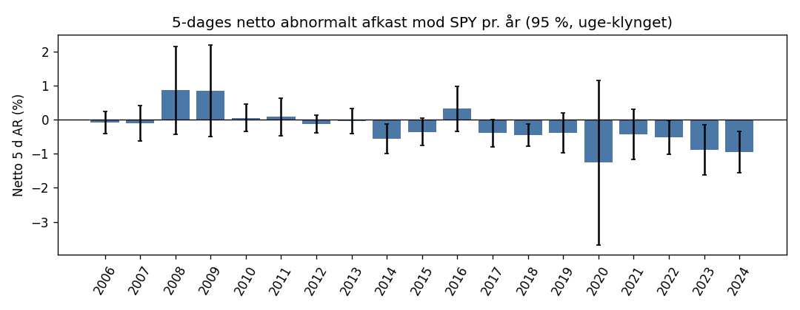

# Backtest v1 – insiderkøb efter offentliggørelse (in-sample 2006–2024)

Genereret 2026-11-05 af `research/src/analyze.py`. Regler som `docs/prereg.md` v1:
- entry ved første åbning mindst 10 minutter efter EDGAR-accepttiden;
- frosne omkostninger (costs.json v3);
- AR i DKK mod SPY (primær) og IWM (sekundær);
- enhed = (ticker, entry-dag).

Holdout 2025–2026 indgår ikke her. Der er ikke brugt LLM på historiske hændelser.

## 1. Data og dækning (survivorship)

Kandidatsignaler er Form 4-køb med kode P/A på mindst $50k pr. Form 4 og en Form 4-kurs på mindst $2, hvor udstederens navn ikke tyder på en fond eller trust.
Kursdata kommer fra Yahoo chart v8 via udstederens nuværende ticker (SEC) og ellers Form 4-symbolet.
Gratis kursdata mangler typisk afnoterede selskaber, så "uden kursdata" er et mål for survivorship bias.

| År (filing) | Kandidater | Uden kursdata | Andel | Kurs-mismatch | Uden accepttid |
|---|---|---|---|---|---|
| 2006 | 6.707 | 3.968 | 59,2 % | 978 | 0,0 % |
| 2007 | 8.626 | 4.830 | 56,0 % | 1.337 | 0,0 % |
| 2008 | 10.514 | 5.362 | 51,0 % | 1.934 | 0,0 % |
| 2009 | 4.233 | 2.078 | 49,1 % | 625 | 0,0 % |
| 2010 | 4.155 | 1.806 | 43,5 % | 822 | 0,0 % |
| 2011 | 5.778 | 2.694 | 46,6 % | 789 | 0,0 % |
| 2012 | 4.729 | 2.047 | 43,3 % | 595 | 0,0 % |
| 2013 | 4.269 | 1.972 | 46,2 % | 706 | 0,0 % |
| 2014 | 5.312 | 2.422 | 45,6 % | 581 | 0,0 % |
| 2015 | 6.473 | 2.675 | 41,3 % | 774 | 0,0 % |
| 2016 | 5.573 | 2.124 | 38,1 % | 551 | 0,0 % |
| 2017 | 4.976 | 1.722 | 34,6 % | 523 | 0,0 % |
| 2018 | 6.395 | 2.143 | 33,5 % | 759 | 0,0 % |
| 2019 | 5.683 | 1.629 | 28,7 % | 746 | 0,0 % |
| 2020 | 6.748 | 1.696 | 25,1 % | 834 | 0,0 % |
| 2021 | 5.715 | 1.508 | 26,4 % | 829 | 0,0 % |
| 2022 | 6.177 | 1.100 | 17,8 % | 589 | 0,0 % |
| 2023 | 4.744 | 704 | 14,8 % | 378 | 0,0 % |
| 2024 | 3.897 | 333 | 8,5 % | 434 | 0,0 % |
| **I alt** | **110.704** | **42.813** | **38,7 %** | 14.784 | 0,0 % |

Signaler efter filter (in-sample, første filter der fejler):

| Status | Signaler |
|---|---|
| ingen kursdata | 49.463 |
| ok | 42.506 |
| kurs-mismatch | 16.958 |
| fond/trust (navn) | 11.135 |
| ADV < $500k | 6.362 |
| børs | 3.182 |
| kurs < $2 | 2.822 |
| 10b5-1 | 2.031 |
| instrument | 120 |

**Kursfilteret på ujusterede i stedet for justerede kurser** (signaler med kurs ved entry, n = 57.023): 2.060 faldt ud (ujusteret < $2, justeret ≥ $2, typisk før en senere reverse split), og 94 kom med (ujusteret ≥ $2, justeret < $2, typisk før en senere split).

## 2. Primær metrik: 5-dages netto abnormalt afkast i DKK mod SPY

Enheder: **34.842** i 992 ISO-uger (2006-01-04 – 2024-12-31); i gennemsnit 35,1 enheder pr. uge.

| Mål | Værdi |
|---|---|
| Gennemsnit | -0,34 % |
| **SD pr. enhed** | **7,66 %** |
| SD efter winsorisering 1/99 % (kun til orientering) | 6,48 % |
| SD 2018–2024 (17.127 enheder) | 8,69 % |
| SE, uafhængige enheder | 0,041 % |
| **SE, uge-klynget** | **0,133 %** |
| SE, to-vejs klynget (uge + udsteder) | 0,135 % |
| Designeffekt (SE²-forhold, uge) | 10,44 |
| ρ inden for ugen (m_eff = 62,1) | 0,154 |
| 95 %-interval (uge-klynget) | [-0,60 %; -0,08 %] |
| Ensidet nedre grænse 95 % / 99 % (prereg-bootstrap, 10.000 gentagelser, seed 20261104) | -0,57 % / -0,67 % |

## 3. Påkrævet N (SD fra afsnit 2)

N er det antal enheder, der skal til for at den ensidede nedre grænse ligger over 0, når den sande effekt er δ.
(a) 50 % styrke svarer til regnemåden i prereg afsnit 10: gennemsnittet skal ligge z·SD/√N over 0.
(b) 80 % styrke er den sædvanlige definition på at kunne påvise en effekt.
Designeffekten afhænger af, hvor mange enheder der falder i samme uge. "Backtest" bruger backtestens egen (deff = 10,44).
"10/uge" bruger ρ = 0,154 med 10 enheder pr. uge (deff = 2,39), hvilket er nærmere ledgerens forventede tempo.

| δ (netto 5 d) | Styrke | 95 % · deff 1 | 95 % · 10/uge | 95 % · backtest | 99 % · deff 1 | 99 % · 10/uge | 99 % · backtest |
|---|---|---|---|---|---|---|---|
| +0,5 % | 50 % (prereg-logik) | 636 | 1.519 | 6.633 | 1.271 | 3.037 | 13.267 |
| +0,5 % | 80 % | 1.452 | 3.469 | 15.157 | 2.357 | 5.632 | 24.603 |
| +1,0 % | 50 % (prereg-logik) | 159 | 380 | 1.659 | 318 | 760 | 3.317 |
| +1,0 % | 80 % | 363 | 868 | 3.790 | 590 | 1.408 | 6.151 |
| +1,5 % | 50 % (prereg-logik) | 71 | 169 | 737 | 142 | 338 | 1.475 |
| +1,5 % | 80 % | 162 | 386 | 1.685 | 262 | 626 | 2.734 |

## 4. Effekt pr. horisont

| Horisont | N | Brutto mod SPY | Netto mod SPY | Netto mod IWM | Netto, entry én dag senere |
|---|---|---|---|---|---|
| 1 d | 34.842 | +0,35 % [+0,28 %; +0,41 %] | -0,55 % [-0,61 %; -0,49 %] | -0,51 % [-0,56 %; -0,46 %] | -0,85 % [-0,91 %; -0,79 %] |
| 5 d | 34.842 | +0,56 % [+0,30 %; +0,82 %] | -0,34 % [-0,60 %; -0,08 %] | -0,27 % [-0,41 %; -0,13 %] | -0,70 % [-0,96 %; -0,45 %] |
| 21 d | 34.842 | +0,61 % [+0,15 %; +1,06 %] | -0,29 % [-0,75 %; +0,17 %] | -0,09 % [-0,36 %; +0,18 %] | -0,70 % [-1,13 %; -0,27 %] |
| 63 d | 34.842 | +1,21 % [+0,47 %; +1,94 %] | +0,31 % [-0,42 %; +1,05 %] | +0,52 % [+0,02 %; +1,02 %] | -0,09 % [-0,84 %; +0,65 %] |

Intervaller: 95 %, uge-klynget. "Entry én dag senere" er følsomheden for manuel scanning.

### 5. Effekt pr. år

| Spand | N | Brutto 5 d | Netto 5 d | Netto 21 d |
|---|---|---|---|---|
| 2006 | 1.022 | +0,85 % [+0,53 %; +1,18 %] | -0,09 % [-0,40 %; +0,23 %] | +0,40 % [-0,35 %; +1,15 %] |
| 2007 | 1.480 | +0,80 % [+0,27 %; +1,33 %] | -0,12 % [-0,64 %; +0,40 %] | -0,25 % [-1,08 %; +0,58 %] |
| 2008 | 2.048 | +1,72 % [+0,43 %; +3,01 %] | +0,86 % [-0,43 %; +2,15 %] | +2,77 % [+0,67 %; +4,88 %] |
| 2009 | 969 | +1,75 % [+0,39 %; +3,11 %] | +0,84 % [-0,50 %; +2,19 %] | +4,39 % [+1,45 %; +7,33 %] |
| 2010 | 1.031 | +0,98 % [+0,58 %; +1,38 %] | +0,05 % [-0,36 %; +0,46 %] | +0,70 % [-0,03 %; +1,43 %] |
| 2011 | 1.604 | +1,00 % [+0,46 %; +1,54 %] | +0,08 % [-0,47 %; +0,62 %] | +0,34 % [-0,45 %; +1,13 %] |
| 2012 | 1.368 | +0,78 % [+0,52 %; +1,04 %] | -0,13 % [-0,39 %; +0,12 %] | +0,13 % [-0,60 %; +0,86 %] |
| 2013 | 1.077 | +0,82 % [+0,44 %; +1,19 %] | -0,04 % [-0,42 %; +0,33 %] | +1,08 % [+0,31 %; +1,85 %] |
| 2014 | 1.533 | +0,32 % [-0,11 %; +0,75 %] | -0,57 % [-1,00 %; -0,14 %] | -1,16 % [-2,04 %; -0,27 %] |
| 2015 | 1.982 | +0,53 % [+0,12 %; +0,94 %] | -0,36 % [-0,77 %; +0,05 %] | -0,86 % [-1,83 %; +0,10 %] |
| 2016 | 1.786 | +1,21 % [+0,55 %; +1,87 %] | +0,32 % [-0,34 %; +0,98 %] | +1,94 % [+0,82 %; +3,05 %] |
| 2017 | 1.815 | +0,48 % [+0,07 %; +0,88 %] | -0,39 % [-0,79 %; +0,01 %] | +0,11 % [-0,60 %; +0,81 %] |
| 2018 | 2.148 | +0,41 % [+0,09 %; +0,74 %] | -0,45 % [-0,77 %; -0,12 %] | +0,11 % [-0,80 %; +1,02 %] |
| 2019 | 2.090 | +0,48 % [-0,10 %; +1,07 %] | -0,39 % [-0,98 %; +0,19 %] | -0,35 % [-1,75 %; +1,06 %] |
| 2020 | 2.937 | -0,38 % [-2,80 %; +2,04 %] | -1,26 % [-3,67 %; +1,15 %] | -1,82 % [-5,53 %; +1,89 %] |
| 2021 | 2.298 | +0,47 % [-0,27 %; +1,20 %] | -0,43 % [-1,16 %; +0,30 %] | -1,79 % [-3,30 %; -0,28 %] |
| 2022 | 3.036 | +0,41 % [-0,09 %; +0,90 %] | -0,52 % [-1,02 %; -0,02 %] | -1,09 % [-1,96 %; -0,21 %] |
| 2023 | 2.441 | +0,03 % [-0,72 %; +0,77 %] | -0,89 % [-1,63 %; -0,16 %] | -1,72 % [-3,47 %; +0,03 %] |
| 2024 | 2.177 | -0,03 % [-0,64 %; +0,58 %] | -0,95 % [-1,56 %; -0,34 %] | -2,49 % [-3,45 %; -1,53 %] |

Trend i netto 5 d: -0,075 % pr. år (uge-klynget SE +0,021 %; 95 %-interval [-0,117 %; -0,034 %]).

## 6. Effekt pr. feature (in-sample, univariat)

Alle features beregnes punkt-i-tid (kun data kendt ved ankeret). Intervaller: 95 %, uge-klynget. Spand med under 30 enheder vises som "for få".

### Rutine/opportunistisk (Cohen, Malloy & Pomorski; kræver 3 års historik → fra 2009)

| Spand | N | Brutto 5 d | Netto 5 d | Netto 21 d |
|---|---|---|---|---|
| opportunistisk | 7.066 | +0,67 % [+0,36 %; +0,99 %] | -0,23 % [-0,54 %; +0,09 %] | -0,48 % [-1,06 %; +0,09 %] |
| rutine | 1.513 | +0,40 % [+0,03 %; +0,78 %] | -0,47 % [-0,84 %; -0,10 %] | +0,03 % [-0,86 %; +0,93 %] |
| ukendt | 26.263 | +0,54 % [+0,26 %; +0,81 %] | -0,36 % [-0,64 %; -0,08 %] | -0,26 % [-0,74 %; +0,22 %] |

### Rolle (højeste i enheden)

| Spand | N | Brutto 5 d | Netto 5 d | Netto 21 d |
|---|---|---|---|---|
| CEO | 6.947 | +0,79 % [+0,43 %; +1,16 %] | -0,12 % [-0,49 %; +0,24 %] | +0,04 % [-0,55 %; +0,63 %] |
| CFO | 1.433 | +0,87 % [+0,36 %; +1,38 %] | +0,00 % [-0,51 %; +0,52 %] | +0,53 % [-0,31 %; +1,37 %] |
| anden officer | 4.308 | +0,32 % [-0,12 %; +0,75 %] | -0,56 % [-1,00 %; -0,12 %] | -0,63 % [-1,38 %; +0,11 %] |
| director | 15.921 | +0,46 % [+0,20 %; +0,72 %] | -0,41 % [-0,68 %; -0,15 %] | -0,44 % [-0,94 %; +0,06 %] |
| 10 %-ejer | 5.692 | +0,60 % [+0,33 %; +0,87 %] | -0,35 % [-0,62 %; -0,08 %] | -0,33 % [-0,89 %; +0,22 %] |
| anden | 541 | +1,14 % [+0,28 %; +1,99 %] | +0,16 % [-0,69 %; +1,01 %] | +1,02 % [-0,61 %; +2,65 %] |

### Antal personlige købere i 10 dage

| Spand | N | Brutto 5 d | Netto 5 d | Netto 21 d |
|---|---|---|---|---|
| 0 (kun enheder) | 2.951 | +0,73 % [+0,33 %; +1,12 %] | -0,25 % [-0,64 %; +0,14 %] | -0,51 % [-1,28 %; +0,27 %] |
| 1 | 23.642 | +0,53 % [+0,31 %; +0,75 %] | -0,37 % [-0,58 %; -0,15 %] | -0,20 % [-0,61 %; +0,21 %] |
| 2 | 5.376 | +0,70 % [+0,37 %; +1,04 %] | -0,19 % [-0,52 %; +0,15 %] | -0,48 % [-1,16 %; +0,20 %] |
| 3+ | 2.873 | +0,37 % [-0,55 %; +1,30 %] | -0,48 % [-1,41 %; +0,44 %] | -0,44 % [-1,65 %; +0,77 %] |

### Fondskøb / ejerskab

| Spand | N | Brutto 5 d | Netto 5 d | Netto 21 d |
|---|---|---|---|---|
| direkte person | 21.872 | +0,46 % [+0,14 %; +0,77 %] | -0,42 % [-0,74 %; -0,11 %] | -0,26 % [-0,78 %; +0,26 %] |
| indirekte privat | 1.870 | +0,31 % [-0,03 %; +0,66 %] | -0,60 % [-0,94 %; -0,25 %] | -0,90 % [-1,66 %; -0,15 %] |
| blandet | 868 | +1,35 % [+0,70 %; +1,99 %] | +0,42 % [-0,22 %; +1,07 %] | +0,06 % [-1,03 %; +1,14 %] |
| fond/enhed | 10.232 | +0,76 % [+0,52 %; +1,00 %] | -0,17 % [-0,41 %; +0,07 %] | -0,28 % [-0,76 %; +0,20 %] |

### Køb til en udbudskurs (fodnote eller 424B-kursmatch)

| Spand | N | Brutto 5 d | Netto 5 d | Netto 21 d |
|---|---|---|---|---|
| nej | 33.819 | +0,55 % [+0,28 %; +0,81 %] | -0,35 % [-0,62 %; -0,08 %] | -0,31 % [-0,77 %; +0,16 %] |
| ja | 1.023 | +0,98 % [+0,29 %; +1,68 %] | +0,08 % [-0,61 %; +0,77 %] | +0,26 % [-1,10 %; +1,61 %] |

### Beholdningsstigning

| Spand | N | Brutto 5 d | Netto 5 d | Netto 21 d |
|---|---|---|---|---|
| < 5 % | 11.535 | +0,53 % [+0,31 %; +0,75 %] | -0,41 % [-0,63 %; -0,19 %] | -0,45 % [-0,87 %; -0,03 %] |
| 5–20 % | 7.565 | +0,61 % [+0,26 %; +0,96 %] | -0,28 % [-0,63 %; +0,07 %] | -0,13 % [-0,71 %; +0,46 %] |
| 20–100 % | 7.685 | +0,52 % [+0,14 %; +0,89 %] | -0,36 % [-0,73 %; +0,01 %] | -0,26 % [-0,93 %; +0,41 %] |
| > 100 % | 3.168 | +0,70 % [+0,26 %; +1,14 %] | -0,17 % [-0,61 %; +0,27 %] | -0,07 % [-0,86 %; +0,73 %] |
| ny position | 4.882 | +0,52 % [+0,25 %; +0,80 %] | -0,33 % [-0,61 %; -0,06 %] | -0,36 % [-0,85 %; +0,14 %] |
| ukendt | 7 | for få | for få | for få |

### Kursudvikling 20 handelsdage før (kvintiler)

| Spand | N | Brutto 5 d | Netto 5 d | Netto 21 d |
|---|---|---|---|---|
| Q1: −87 % til −15 % | 6.821 | +0,79 % [-0,18 %; +1,76 %] | -0,07 % [-1,04 %; +0,90 %] | -0,26 % [-1,53 %; +1,01 %] |
| Q2: −15 % til −7 % | 6.820 | +0,45 % [+0,20 %; +0,71 %] | -0,43 % [-0,68 %; -0,17 %] | -0,44 % [-1,07 %; +0,18 %] |
| Q3: −7 % til −1 % | 6.820 | +0,38 % [+0,23 %; +0,54 %] | -0,51 % [-0,67 %; -0,36 %] | -0,35 % [-0,70 %; +0,00 %] |
| Q4: −1 % til +6 % | 6.820 | +0,34 % [+0,19 %; +0,48 %] | -0,57 % [-0,71 %; -0,43 %] | -0,53 % [-0,85 %; -0,22 %] |
| Q5: +6 % til +25733 % | 6.820 | +0,78 % [+0,51 %; +1,06 %] | -0,16 % [-0,43 %; +0,11 %] | +0,14 % [-0,41 %; +0,69 %] |
| ukendt | 741 | +0,97 % [-0,01 %; +1,95 %] | +0,12 % [-0,85 %; +1,10 %] | -0,39 % [-2,29 %; +1,52 %] |

### Kursudvikling 60 handelsdage før (kvintiler)

| Spand | N | Brutto 5 d | Netto 5 d | Netto 21 d |
|---|---|---|---|---|
| Q1: −91 % til −24 % | 6.749 | +1,36 % [+0,51 %; +2,21 %] | +0,48 % [-0,37 %; +1,33 %] | +1,24 % [-0,01 %; +2,49 %] |
| Q2: −24 % til −11 % | 6.749 | +0,27 % [-0,11 %; +0,66 %] | -0,61 % [-0,99 %; -0,23 %] | -0,92 % [-1,65 %; -0,19 %] |
| Q3: −11 % til −2 % | 6.749 | +0,23 % [+0,06 %; +0,39 %] | -0,67 % [-0,84 %; -0,51 %] | -0,78 % [-1,17 %; -0,39 %] |
| Q4: −2 % til +9 % | 6.749 | +0,24 % [+0,10 %; +0,37 %] | -0,67 % [-0,80 %; -0,53 %] | -0,80 % [-1,13 %; -0,46 %] |
| Q5: +9 % til +5067 % | 6.749 | +0,66 % [+0,44 %; +0,88 %] | -0,26 % [-0,48 %; -0,04 %] | -0,01 % [-0,50 %; +0,47 %] |
| ukendt | 1.097 | +0,80 % [+0,06 %; +1,53 %] | -0,10 % [-0,83 %; +0,63 %] | -1,40 % [-2,89 %; +0,10 %] |

### Kursudvikling 250 handelsdage før (kvintiler)

| Spand | N | Brutto 5 d | Netto 5 d | Netto 21 d |
|---|---|---|---|---|
| Q1: −99 % til −36 % | 6.452 | +1,49 % [+0,64 %; +2,33 %] | +0,58 % [-0,26 %; +1,42 %] | +1,59 % [+0,37 %; +2,81 %] |
| Q2: −36 % til −16 % | 6.452 | +0,18 % [-0,17 %; +0,52 %] | -0,72 % [-1,06 %; -0,37 %] | -1,10 % [-1,75 %; -0,45 %] |
| Q3: −16 % til +1 % | 6.451 | +0,10 % [-0,18 %; +0,39 %] | -0,78 % [-1,06 %; -0,50 %] | -1,15 % [-1,69 %; -0,61 %] |
| Q4: +1 % til +25 % | 6.452 | +0,20 % [+0,03 %; +0,37 %] | -0,68 % [-0,84 %; -0,51 %] | -0,58 % [-0,91 %; -0,26 %] |
| Q5: +25 % til +119900 % | 6.452 | +0,71 % [+0,48 %; +0,93 %] | -0,19 % [-0,42 %; +0,03 %] | +0,09 % [-0,39 %; +0,58 %] |
| ukendt | 2.583 | +0,87 % [+0,40 %; +1,34 %] | -0,08 % [-0,55 %; +0,39 %] | -1,06 % [-2,01 %; -0,10 %] |

### Afstand til 52-ugers-top (kvintiler)

| Spand | N | Brutto 5 d | Netto 5 d | Netto 21 d |
|---|---|---|---|---|
| Q1: −99 % til −47 % | 6.969 | +1,53 % [+0,71 %; +2,36 %] | +0,61 % [-0,21 %; +1,44 %] | +1,32 % [+0,15 %; +2,49 %] |
| Q2: −47 % til −30 % | 6.968 | +0,42 % [+0,03 %; +0,81 %] | -0,48 % [-0,87 %; -0,09 %] | -0,96 % [-1,64 %; -0,28 %] |
| Q3: −30 % til −19 % | 6.971 | +0,22 % [-0,04 %; +0,48 %] | -0,67 % [-0,93 %; -0,41 %] | -0,95 % [-1,47 %; -0,44 %] |
| Q4: −19 % til −8 % | 6.965 | +0,21 % [+0,04 %; +0,37 %] | -0,69 % [-0,85 %; -0,52 %] | -0,89 % [-1,31 %; -0,47 %] |
| Q5: −8 % til +0 % | 6.969 | +0,42 % [+0,26 %; +0,58 %] | -0,46 % [-0,62 %; -0,30 %] | +0,04 % [-0,33 %; +0,40 %] |

### Markedsværdi (aktier i omløb fra XBRL × ujusteret kurs)

| Spand | N | Brutto 5 d | Netto 5 d | Netto 21 d |
|---|---|---|---|---|
| < $300 mio. | 3.612 | +1,34 % [+0,87 %; +1,81 %] | +0,07 % [-0,40 %; +0,55 %] | -0,13 % [-1,00 %; +0,73 %] |
| $0,3–2 mia. | 9.016 | +0,46 % [+0,12 %; +0,79 %] | -0,50 % [-0,84 %; -0,16 %] | -0,50 % [-1,12 %; +0,13 %] |
| $2–10 mia. | 6.378 | +0,07 % [-0,30 %; +0,45 %] | -0,65 % [-1,02 %; -0,28 %] | -0,76 % [-1,39 %; -0,14 %] |
| > $10 mia. | 4.226 | -0,02 % [-0,20 %; +0,16 %] | -0,62 % [-0,80 %; -0,44 %] | -0,75 % [-1,08 %; -0,41 %] |
| ukendt | 11.610 | +0,87 % [+0,53 %; +1,22 %] | -0,06 % [-0,41 %; +0,28 %] | +0,25 % [-0,39 %; +0,89 %] |

### C-suite (titel med CEO/CFO/COO/Chief/President)

| Spand | N | Brutto 5 d | Netto 5 d | Netto 21 d |
|---|---|---|---|---|
| ja | 10.494 | +0,70 % [+0,34 %; +1,06 %] | -0,20 % [-0,56 %; +0,16 %] | -0,08 % [-0,67 %; +0,51 %] |
| nej | 24.348 | +0,50 % [+0,26 %; +0,74 %] | -0,40 % [-0,63 %; -0,16 %] | -0,38 % [-0,81 %; +0,05 %] |

### Cluster (≥ 2 købere i 10 dage)

| Spand | N | Brutto 5 d | Netto 5 d | Netto 21 d |
|---|---|---|---|---|
| ja | 11.117 | +0,59 % [+0,19 %; +0,99 %] | -0,30 % [-0,70 %; +0,10 %] | -0,41 % [-1,05 %; +0,23 %] |
| nej | 23.725 | +0,54 % [+0,33 %; +0,76 %] | -0,36 % [-0,57 %; -0,14 %] | -0,23 % [-0,64 %; +0,18 %] |

### 7. Effekt pr. likviditetsspand (omkostningerne varierer)

| Spand | N | Brutto 5 d | Netto 5 d | Netto 21 d |
|---|---|---|---|---|
| $0–1 mio. | 2.904 | +1,33 % [+0,93 %; +1,73 %] | -0,37 % [-0,77 %; +0,03 %] | +0,19 % [-0,60 %; +0,98 %] |
| $1–5 mio. | 8.861 | +0,86 % [+0,59 %; +1,12 %] | -0,24 % [-0,51 %; +0,02 %] | -0,09 % [-0,59 %; +0,42 %] |
| $5–50 mio. | 13.619 | +0,47 % [+0,18 %; +0,76 %] | -0,33 % [-0,62 %; -0,04 %] | -0,31 % [-0,91 %; +0,29 %] |
| ≥ $50 mio. | 9.458 | +0,17 % [-0,20 %; +0,54 %] | -0,43 % [-0,80 %; -0,06 %] | -0,60 % [-1,08 %; -0,12 %] |

Round-trip pr. spand (costs.json v3): $0–1 mio.: 1,7 %, $1–5 mio.: 1,1 %, $5–50 mio.: 0,8 %, ≥ $50 mio.: 0,6 %.

## 8. 10b5-1 i to perioder

Afkrydsningsfeltet for Rule 10b5-1 findes i Form 4 fra 2023. Før det fanges planer kun via fodnoter, så status er reelt ukendt.

| Periode | Signaler, der ellers består filtrene | Udelukket som 10b5-1 | Andel | Enheder | Netto 5 d [95 %] |
|---|---|---|---|---|---|
| 2006–2022 (kun fodnoter) | 38.847 | 1.870 | 4,8 % | 30.224 | -0,25 % [-0,54 %; +0,04 %] |
| 2023–2024 (afkrydsningsfelt) | 5.690 | 161 | 2,8 % | 4.618 | -0,92 % [-1,40 %; -0,44 %] |

## 9. Robusthed: kalendertidsportefølje

Ligevægtet portefølje af alle åbne positioner (entry-åbning → 5. lukning), dagligt afkast minus SPY i USD, omkostningen fordelt over de 5 dage. 4.784 handelsdage. Gennemsnitligt dagligt netto abnormalt afkast: **-5,4 bp** (Newey-West SE 1,7 bp, t = -3,10).

## 10. Kapacitet

10.000 kr. ≈ $1.500 pr. handel. Medianen af ADV er 13.109.823 $/dag, så en handel svarer til 0,011 % af en dags omsætning (≤ 0,3 % selv ved minimumskravet på $500k). Kapaciteten begrænser ikke denne strategi.

## 11. Modeller ude af sample (walk-forward 2012–2024)

For hvert testår Y trænes modellerne på enheder, hvis 5-dages udfald lå før 1.1.Y. Ingen tilfældig opdeling.
Målet er netto 5 d, winsoriseret 1/99 % i træningen. Der er to modeller (ridge og LightGBM) og to regler, i alt
**4 varianter**. Bonferroni-α = 5 % ÷ 4 = 1,25 %.

Kriterium, fastlagt før kørslen. En model "slår baselines" kun, hvis begge betingelser holder:
1. Udvalgets netto 5 d har en ensidet 95 %-nedre grænse over 0 (uge-klynget).
2. Den ugentlige forskel til den bedste baseline har en ensidet nedre grænse over 0 ved Bonferroni-α.

| Udvalg | Enheder | Netto 5 d [95 %, uge-klynget] | Ensidet 95 %-nedre |
|---|---|---|---|
| Baseline: alle enheder | 26.688 | -0,53 % [-0,85 %; -0,22 %] | -0,80 % |
| Baseline: kun C-suite (bedst) | 8.248 | -0,39 % [-0,81 %; +0,03 %] | -0,74 % |
| Baseline: kun clusters (≥ 2 købere/10 d) | 8.737 | -0,54 % [-1,02 %; -0,06 %] | -0,94 % |

| Variant | Enheder | Netto 5 d [95 %] | Ensidet 95 %-nedre | Uge-forskel mod "kun C-suite" | Nedre grænse ved Bonferroni | Består |
|---|---|---|---|---|---|---|
| ridge: forudsagt > 0 | 10.825 | -0,26 % [-0,81 %; +0,30 %] | -0,72 % | +0,22 % (671 uger) | -0,08 % | nej |
| ridge: øverste tredjedel | 9.552 | -0,23 % [-0,83 %; +0,37 %] | -0,74 % | +0,41 % (661 uger) | +0,07 % | nej |
| lightgbm: forudsagt > 0 | 8.816 | -0,06 % [-0,65 %; +0,54 %] | -0,56 % | +0,37 % (667 uger) | +0,03 % | nej |
| lightgbm: øverste tredjedel | 9.837 | -0,21 % [-0,79 %; +0,37 %] | -0,70 % | +0,35 % (664 uger) | +0,03 % | nej |

**Ingen model slår de naive baselines ude af sample efter omkostninger – intet TypeScript-scoringsmodul.**

## 12. Features til live-beregning i appen

Hver feature er testet som forskellen mellem enheder med og uden den (netto 5 d, uge-klynget).
En feature er "holdbar", hvis forskellen har et 95 %-interval uden 0 over hele in-sample-perioden og samme fortegn i 2006–2015 og 2016–2024.

| Feature | Andel | Forskel netto 5 d [95 %] | 2006–2015 | 2016–2024 | Holdbar |
|---|---|---|---|---|---|
| opportunistisk køb (CMP) | 20,3 % | +0,14 % [-0,09 %; +0,37 %] | +0,14 % | +0,25 % | nej |
| rutinekøb (CMP) | 4,3 % | -0,14 % [-0,56 %; +0,28 %] | -0,32 % | -0,14 % | nej |
| CEO eller CFO | 24,1 % | +0,31 % [+0,08 %; +0,54 %] | +0,23 % | +0,38 % | ja |
| director | 45,7 % | -0,14 % [-0,32 %; +0,04 %] | -0,16 % | -0,12 % | nej |
| 10 %-ejer | 16,3 % | -0,02 % [-0,34 %; +0,30 %] | -0,28 % | +0,17 % | nej |
| C-suite-titel | 30,1 % | +0,20 % [-0,02 %; +0,41 %] | +0,25 % | +0,18 % | nej |
| ≥ 2 personlige købere/10 d | 23,7 % | +0,06 % [-0,28 %; +0,41 %] | +0,44 % | -0,10 % | nej |
| fond/enhed | 29,4 % | +0,23 % [-0,02 %; +0,48 %] | -0,03 % | +0,42 % | nej |
| køb til udbudskurs | 2,9 % | +0,43 % [-0,30 %; +1,16 %] | +0,16 % | +0,65 % | nej |
| ny position eller > 100 % stigning | 23,1 % | +0,09 % [-0,10 %; +0,27 %] | -0,11 % | +0,18 % | nej |
| kursfald > 20 % de seneste 60 d | 24,0 % | +0,81 % [+0,12 %; +1,50 %] | +1,69 % | +0,41 % | ja |
| > 30 % under 52-ugers-top | 40,5 % | +0,66 % [+0,23 %; +1,09 %] | +1,28 % | +0,41 % | ja |
| markedsværdi < $300 mio. | 10,8 % | +0,38 % [-0,04 %; +0,80 %] | +0,21 % | +0,64 % | nej |
| ADV < $5 mio. | 33,8 % | +0,09 % [-0,15 %; +0,34 %] | +0,26 % | -0,02 % | nej |

Appen bør beregne disse live: CEO eller CFO, kursfald > 20 % de seneste 60 d, > 30 % under 52-ugers-top. ADV og likviditetsspand beregnes allerede, fordi de styrer omkostningen.

## 13. Holdout 2025–2026

Kørt 05.11.2026 efter `research/reports/holdout-plan.md` (commit cdae2cb 2026-11-05T12:54:50+01:00, sha256 81d992fd72e9…).
`units.parquet` har sha256 984eecbaddfe… (planen: 984eecbaddfe…).
Holdout-enheder har entry fra 2025-01-01 til 2026-04-01.
Der er to bekræftende tests med Bonferroni: hver bestås, hvis den ensidede 97,5 %-nedre grænse er over 0 (uge-klynget).

### Test 1 – basisstrategien

| Mål | Værdi |
|---|---|
| Enheder / uger | 3.643 / 66 |
| Gennemsnit netto 5 d mod SPY | -0,17 % |
| SD pr. enhed | 8,53 % |
| SE, uge-klynget | 0,247 % |
| **Ensidet 97,5 %-nedre grænse (uge-klynget)** | **-0,65 %** |
| Ensidet 95 %-nedre grænse, prereg-bootstrap (kun til orientering) | -0,58 % |
| **Resultat** | **ikke bestået: nedre grænse ≤ 0** |

### Test 2 – CEO/CFO-køb > 30 % under 52-ugers-toppen

| Mål | Værdi |
|---|---|
| Enheder / uger | 484 / 61 |
| Gennemsnit netto 5 d mod SPY | +0,24 % |
| SD pr. enhed | 8,92 % |
| SE, uge-klynget | 0,439 % |
| **Ensidet 97,5 %-nedre grænse (uge-klynget)** | **-0,63 %** |
| Ensidet 95 %-nedre grænse, prereg-bootstrap (kun til orientering) | -0,49 % |
| **Resultat** | **ikke bestået: nedre grænse ≤ 0** |

### Beskrivende (ingen konklusioner)

Intervallerne er 95 % og uge-klyngede. Sidste kolonne er den ensidede 97,5 %-nedre grænse.

**Basisstrategien:**

| Horisont | N | Brutto mod SPY | Netto mod SPY | Netto mod IWM | Ensidet nedre grænse, netto SPY |
|---|---|---|---|---|---|
| 1 d | 3.643 | +0,35 % [+0,19 %; +0,50 %] | -0,51 % [-0,67 %; -0,36 %] | -0,57 % [-0,72 %; -0,42 %] | -0,67 % |
| 5 d | 3.643 | +0,69 % [+0,21 %; +1,18 %] | -0,17 % [-0,65 %; +0,32 %] | -0,29 % [-0,67 %; +0,09 %] | -0,65 % |
| 21 d | 3.643 | +1,32 % [+0,19 %; +2,44 %] | +0,46 % [-0,66 %; +1,58 %] | -0,35 % [-1,17 %; +0,48 %] | -0,66 % |
| 63 d | 3.643 | +1,26 % [-0,65 %; +3,17 %] | +0,40 % [-1,50 %; +2,30 %] | -1,28 % [-2,70 %; +0,14 %] | -1,50 % |

**Test 2-reglen:**

| Horisont | N | Brutto mod SPY | Netto mod SPY | Netto mod IWM | Ensidet nedre grænse, netto SPY |
|---|---|---|---|---|---|
| 1 d | 484 | +0,98 % [+0,48 %; +1,47 %] | +0,11 % [-0,38 %; +0,61 %] | +0,08 % [-0,44 %; +0,59 %] | -0,38 % |
| 5 d | 484 | +1,10 % [+0,23 %; +1,97 %] | +0,24 % [-0,63 %; +1,10 %] | +0,10 % [-0,59 %; +0,78 %] | -0,63 % |
| 21 d | 484 | +2,40 % [+0,78 %; +4,03 %] | +1,54 % [-0,08 %; +3,16 %] | +0,63 % [-0,67 %; +1,92 %] | -0,08 % |
| 63 d | 484 | +2,35 % [-0,24 %; +4,94 %] | +1,49 % [-1,10 %; +4,08 %] | -0,34 % [-3,37 %; +2,68 %] | -1,10 % |

**Fortegn pr. feature** (forskel i netto 5 d med/uden flag, uge-klynget):

| Feature | In-sample | Holdout [95 %] | Samme fortegn |
|---|---|---|---|
| opportunistisk køb (CMP) | +0,14 % | -0,40 % [-0,96 %; +0,16 %] | nej |
| rutinekøb (CMP) | -0,14 % | -0,00 % [-0,94 %; +0,94 %] | ja |
| CEO eller CFO | +0,31 % | +0,67 % [-0,06 %; +1,40 %] | ja |
| director | -0,14 % | -0,22 % [-0,79 %; +0,36 %] | ja |
| 10 %-ejer | -0,02 % | -0,39 % [-1,54 %; +0,75 %] | ja |
| C-suite-titel | +0,20 % | +0,61 % [-0,10 %; +1,33 %] | ja |
| ≥ 2 personlige købere/10 d | +0,06 % | +0,40 % [-0,27 %; +1,07 %] | ja |
| fond/enhed | +0,23 % | -0,22 % [-1,09 %; +0,65 %] | nej |
| køb til udbudskurs | +0,43 % | -0,39 % [-2,69 %; +1,91 %] | nej |
| ny position eller > 100 % stigning | +0,09 % | -0,24 % [-0,93 %; +0,45 %] | nej |
| kursfald > 20 % de seneste 60 d | +0,81 % | -0,45 % [-1,45 %; +0,55 %] | nej |
| > 30 % under 52-ugers-top | +0,66 % | -0,20 % [-0,96 %; +0,55 %] | nej |
| markedsværdi < $300 mio. | +0,38 % | +0,71 % [-0,71 %; +2,13 %] | ja |
| ADV < $5 mio. | +0,09 % | -0,43 % [-1,14 %; +0,28 %] | nej |

**Dækning 2025–2026** (survivorship):

| År (filing) | Kandidater | Uden kursdata | Andel | Kurs-mismatch |
|---|---|---|---|---|
| 2025 | 4.580 | 205 | 4,5 % | 357 |
| 2026 | 1.166 | 25 | 2,1 % | 93 |

**Samlet:** Test 1 ikke bestået: nedre grænse ≤ 0; Test 2 ikke bestået: nedre grænse ≤ 0.
